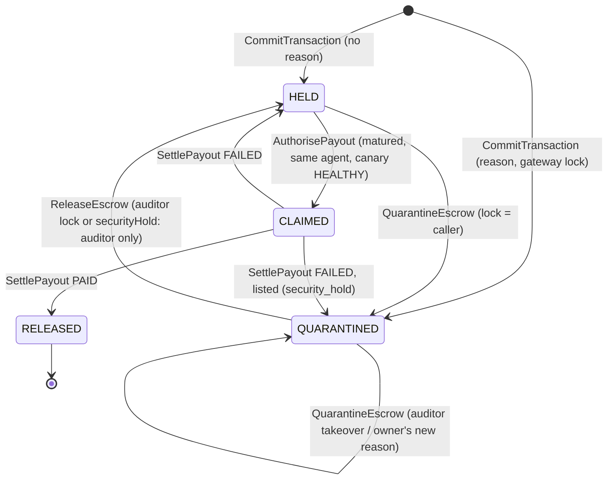

# Commission escrow chaincode (DLT-02, #9)

The `commission` chaincode records the gateway's escrow lifecycle on the [Fabric testnet](fabric-testnet.md), so every model decision, fraud lock and payout authorisation leaves a tamper-evident trail (FR-07, NFR-04, NFR-09). It mirrors the gateway's escrow model (`backend/gateway/src/services/escrow.service.ts`) and does not replace it: Postgres stays the system of record, and the ledger is the audit trail and the payout gate.

- **Code:** `blockchain/chaincode/`. Go, raw `shim` plus `pkg/cid`, run as chaincode-as-a-service (CCaaS).
- **Deploy:** `bash blockchain/network/scripts/deploy_chaincode.sh commission blockchain/chaincode <version> <sequence>`.
- **Tests:** `make fabric-chaincode-test` (unit tests: vet, race, coverage) and `make fabric-commission-e2e` (on the testnet, including the v1.0 → v1.1 upgrade).

Every write:
- takes one strict JSON argument;
- checks the caller's role;
- applies a guarded transition;
- extends the record's digest chain;
- emits one event;
- returns the record as JSON.

## Function contract

| Function | Callers | Request JSON | Effect |
|---|---|---|---|
| `InitLedger` | gateway | `{}` | Writes `meta:ledger {schemaVersion:1, digestAlgorithm:"SHA-256", mspId, txId, txTime}`. A repeat returns it without writing. |
| `CommitTransaction` | gateway | `escrowId, agentRef, stateHash, modelVersion, modelSha256, decision, failSafe, quarantineReason, grossCents, releaseDueAt` | Creates the escrow: HELD or QUARANTINED (see [fail-safe](#fail-safe-status-nfr-08)). |
| `QuarantineEscrow` | gateway, auditor | `requestId, escrowId, reason` | HELD → QUARANTINED, locked by the caller. On a QUARANTINED escrow: the auditor takes over a gateway lock; the lock owner with a new reason updates the reason; anything else is a no-op. A no-op returns the current record, so the gateway compares `lockedBy`/`quarantineReason` to see whether its request took effect. CLAIMED or RELEASED → `INVALID_TRANSITION`. |
| `ReleaseEscrow` | gateway, auditor | `requestId, escrowId, reason, releaseDueAt` | QUARANTINED → HELD. Sets the due date (it may move earlier: a rescore promote) and clears the lock. Only the auditor may release an auditor lock or a security hold, and only the auditor's release clears `securityHold`. |
| `AuthorisePayout` | gateway | `payoutId, agentRef, escrowIds[1..1000], grossCents, carryInCents, carryOutCents, amount, consentDigest, disclosureVersion, canary {status, destinationRef, checkedAt}` | Each escrow must be HELD, not security-held, matured (`releaseDueAt` ≤ tx time) and owned by `agentRef`. Σ escrow cents = `grossCents`, and `grossCents + carryInCents = amount×100 + carryOutCents`. The payout becomes AUTHORISED; the escrows become CLAIMED with `payoutId`. |
| `SettlePayout` | gateway | `payoutId, outcome PAID or FAILED, failureCode (FAILED only), quarantineEscrowIds[] (FAILED only, ⊆ payout)` | PAID: the escrows become RELEASED. FAILED: the escrows go back to HELD, except the listed ones, which become QUARANTINED with `security_hold`. |
| `GetEscrow` / `GetPayout` | gateway, auditor | positional uuid (not JSON) | The record, or `NOT_FOUND`. |

**Events:** `LedgerInitialised`, `EscrowCommitted`, `EscrowQuarantined`, `EscrowReleased`, `PayoutAuthorised`, `PayoutSettled`. The payload is the record. A no-op or an idempotent replay emits no event. Escrow changes made inside `AuthorisePayout` and `SettlePayout` emit no `Escrow*` event: consumers expand `PayoutAuthorised` / `PayoutSettled` through their `escrowIds` and `quarantineEscrowIds`.

**Input formats:** unknown, case-variant, missing or `null` fields are rejected. There are no free-text fields.

| Kind | Format |
|---|---|
| Ids (`escrowId`, `agentRef`, `payoutId`, `requestId`, `destinationRef`) | canonical lowercase UUID |
| Digests (`stateHash`, `consentDigest`, `modelSha256`) | lowercase hex64 (`modelSha256` may be `""`) |
| Codes (`reason`, `quarantineReason`, `failureCode`) | `^[a-z][a-z0-9_]{0,39}$` |
| `modelVersion` | `^[A-Za-z0-9._+-]{1,64}$` |
| `disclosureVersion` | `^[A-Za-z0-9._-]{1,20}$` |
| `decision` | `CLEAR`, `REVIEW` or `QUARANTINE` |
| `canary.status` | `^[A-Z][A-Z_]{0,19}$`; only `HEALTHY` passes |
| Times | RFC3339, stored as UTC with milliseconds (`2026-10-21T09:00:00.000Z`) |
| Cents | JSON integers only (`100.0` and `"100"` are rejected). Escrow `grossCents` 0..10^13; carries 0..99; `amount` ≥ 1 |
| `releaseDueAt` | at most tx time + 72 h + 5 min skew |

**Keys:** `meta:ledger`, `escrow:<uuid>`, `payout:<uuid>`, and `req:<uuid>` holding `{hash, escrowId}`.

## Roles

Deny by default. The role comes from the `role` attribute in the caller's enrollment cert, and it counts only from its own org's MSP.

| Caller | Role | May call |
|---|---|---|
| `gateway@merchant` (MerchantMSP, `role=gateway`) | gateway | every function |
| `auditor1@auditor` (AuditorMSP, `role=auditor`) | auditor | `QuarantineEscrow`, `ReleaseEscrow`, `GetEscrow`, `GetPayout` |
| a MerchantMSP cert with `role=auditor`, an AuditorMSP cert with `role=gateway`, an Admin or peer cert with no role, a non-x509 identity | none | nothing (`UNAUTHORISED`) |

## Escrow states



A payout goes AUTHORISED → PAID or AUTHORISED → FAILED, and both are final. UFAA `REMITTED` is deferred (see `deferred-work.md`).

### Fail-safe status (NFR-08)

`CommitTransaction` derives the status itself and never trusts a status from the caller. The quarantine reason is taken in this order:
1. a non-empty `quarantineReason` from the gateway (e.g. `trust_below_threshold`);
2. `fail_safe`, if `failSafe` is true;
3. `model_decision`, if `decision` is not CLEAR.

No reason gives HELD. Any reason gives QUARANTINED, locked by the gateway. `security_hold` (from Commit or from a Quarantine reason) also sets `securityHold`, which only the auditor can clear.

### Canary = payout preflight

A KES 1 canary cannot detect Fuliza, and the agent decides about their own Fuliza debt through the disclosure. So "canary HEALTHY" is the gateway's attestation that the payout destination is ACTIVE and consent is recorded. `AuthorisePayout` requires `canary.status = HEALTHY` and `checkedAt` within [tx − 24 h, tx + 5 min]. Otherwise it refuses with `CANARY_NOT_HEALTHY`: nothing is written and the escrows stay HELD. It never quarantines.

## Error codes

Every failure message is `CODE: detail`. For state errors (`NOT_FOUND`, `CONFLICT`, `INVALID_TRANSITION`, `NOT_MATURED`, `CANARY_NOT_HEALTHY`, `LOCKED_BY_AUDITOR`) the detail names the escrow or payout id. A format error names the field instead.

| Code | Meaning |
|---|---|
| `UNAUTHORISED` | The caller's role or MSP may not call this function. |
| `INVALID_ARGUMENT` | Malformed JSON, an unknown or missing field, a bad format or range, another agent's escrow, a duplicate id, a sum or carry mismatch, more than 1000 escrows, or an unknown function. |
| `NOT_INITIALISED` | A write before `InitLedger`. |
| `NOT_FOUND` | Unknown escrow or payout. |
| `CONFLICT` | The same escrowId, payoutId or requestId was already used for a different request. |
| `INVALID_TRANSITION` | The record is in the wrong state, e.g. Authorise on a QUARANTINED escrow, or Settle PAID after FAILED. |
| `NOT_MATURED` | Authorise with an escrow whose `releaseDueAt` is after the tx time. |
| `CANARY_NOT_HEALTHY` | The canary is stale, from the future, or not HEALTHY. |
| `LOCKED_BY_AUDITOR` | The gateway tried to release an auditor lock or a security hold. |

**Where #10 sees them:** with the Fabric Gateway SDK, a chaincode error fails endorsement. `submitTransaction` throws an `EndorseError`, and the `CODE: detail` text is in `err.details[].message`, once per endorsing peer. Both peers run the same deterministic code, so the messages match. An infrastructure failure (a peer down, an MVCC conflict, `ENDORSEMENT_POLICY_FAILURE`) has no such code and should be retried.

## Idempotency

| Function | Keyed by |
|---|---|
| `CommitTransaction` | escrowId |
| `AuthorisePayout`, `SettlePayout` | payoutId |
| `QuarantineEscrow`, `ReleaseEscrow` | `requestId` (a UUID per request, stored at `req:<id>`) |

Each record stores the SHA-256 of its canonical request: the function name plus the decoded, normalised request. For Quarantine and Release, the caller's role is also part of the hash. Struct marshalling is field-ordered, times are normalised, and `escrowIds` and `quarantineEscrowIds` are sets (sorted before hashing; a payout stores `escrowIds` sorted). So reordered keys, a reordered id list, or an equal time written another way count as the same request. `canary.checkedAt` is left out of the AuthorisePayout hash, so a retry may refresh it; the stored payout keeps the first value. A no-op Quarantine still stores its `req:` key.

- **Same id + same request:** returns the *current* record, with no write and no event. This holds even after later transitions, so an outbox retry is always safe.
- **Same id + different request:** `CONFLICT`. Exception: a different Settle on a settled payout returns `INVALID_TRANSITION`.

## Integrity, PII and determinism

- **Digest chain:** each record has its own chain: `digest = sha256(prevDigest ‖ "\n" ‖ json(record without digest))`. The genesis value is 64 zeros. The record also stores the `txId` and `txTime` of the tx that last changed it. This chaincode has no history function: the auditor verifies the chain from its own peer's block store. There is no global hot key: `meta:ledger` is written once, so concurrent escrows never MVCC-conflict on it.
- **No PII on chain:** no names, MSISDNs, M-Pesa receipts or raw consent hashes. Agents and destinations appear only as UUIDs. Every string field is a validated id, digest, code or version.
- **HMAC digests:** the gateway's `consentHash` is a SHA-256 whose preimage includes the MSISDN. The MSISDN space is small enough to enumerate, so the hash can be brute-forced. So the chain gets `consentDigest = HMAC-SHA256(gateway key, consentHash)`, and `stateHash` is likewise a gateway-keyed HMAC of the escrow state. The chaincode only checks that both are hex64. **#10 owns the keys and the preimage definitions** (see `deferred-work.md`).
- **Determinism:**
  - time comes only from `GetTxTimestamp`;
  - output never comes from map iteration;
  - there is no randomness;
  - each tx emits at most one `SetEvent`;
  - every check runs before the first write, so a refused tx writes nothing.
- **Tx-timestamp trust:** the client (the gateway) sets the tx timestamp. Every peer uses the same value, so it is deterministic, but it is only as honest as the gateway. Maturity, the 72 h cap and canary freshness all rest on it. The chaincode caps `releaseDueAt` from above only: the minimum hold is the gateway's rule. Peers do not check it against their own clocks, so a compromised gateway could backdate. The auditor's co-endorsement and the off-chain records are the controls.

## Sync contract and the 1000-escrow cap (for #10)

- **`AuthorisePayout` is a synchronous gate.** It must commit before any B2C call. If it is refused, the gateway rolls the claim back and never calls Settle.
- **Every other write goes through an outbox**, ordered per escrow and per payout, and is retried until it commits. Idempotency makes the retries safe.
- **1000-escrow cap:** a shared contract. AuthorisePayout rejects more than 1000 `escrowIds`, so the gateway's `splitClaim` must stop at 1000 escrows (#10 or the payout integration).

## Call examples (#10, Fabric Gateway SDK)

```ts
await contract.submitTransaction('CommitTransaction', JSON.stringify({
  escrowId, agentRef: agentId, stateHash /* HMAC */, modelVersion, modelSha256, decision: 'CLEAR',
  failSafe: false, quarantineReason: '', grossCents: 15000, releaseDueAt: '2026-10-21T09:00:00.000Z' }));

await contract.submitTransaction('AuthorisePayout', JSON.stringify({
  payoutId, agentRef: agentId, escrowIds, grossCents, carryInCents, carryOutCents, amount,
  consentDigest /* HMAC of consentHash */, disclosureVersion: '1',
  canary: { status: 'HEALTHY', destinationRef, checkedAt: new Date().toISOString() } }));

await contract.submitTransaction('SettlePayout', JSON.stringify({
  payoutId, outcome: 'FAILED', failureCode: 'b2c_2001', quarantineEscrowIds: [] }));

await contract.submitTransaction('ReleaseEscrow', JSON.stringify({
  requestId: randomUUID() /* stored with the outbox row, reused on retry */, escrowId,
  reason: 'admin_release', releaseDueAt }));

const escrow = JSON.parse(Buffer.from(await contract.evaluateTransaction('GetEscrow', escrowId)).toString());
```
