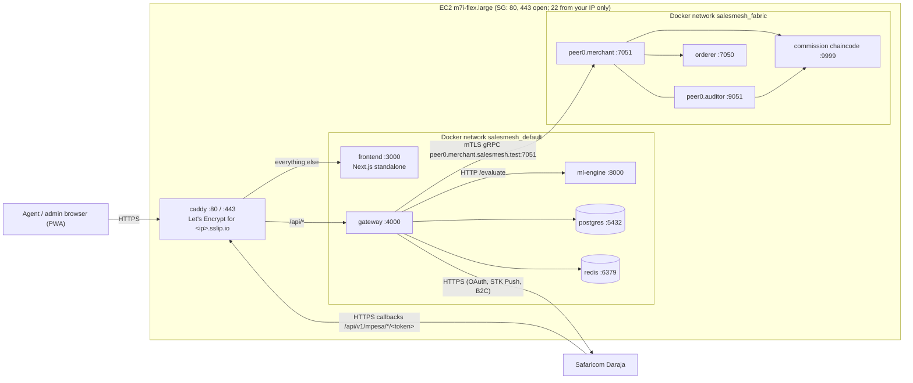

# Deployment: the whole stack on one AWS EC2 VM (#56)

The demo deployment runs everything on one `m7i-flex.large` (2 vCPU, 8 GB, x86) with Ubuntu 24.04:

- the [Fabric testnet](fabric-testnet.md), started by its own scripts;
- the app stack in `infra/docker-compose.yml`: Postgres, Redis, ml-engine, gateway, PWA and Caddy.

Caddy gets a Let's Encrypt certificate for `<elastic-ip>.sslip.io` (sslip.io resolves that name to the IP, so no domain is needed). It serves the PWA and `/api/*` on one origin, and gives Daraja its HTTPS callback URLs. The gateway joins the `salesmesh_fabric` network through `infra/docker-compose.fabric.yml` and talks to `peer0.merchant` over mTLS, as described in [ledger-sync.md](ledger-sync.md).

| File | Role |
|---|---|
| `infra/docker-compose.yml` | App stack. It works on its own with `FABRIC_ENABLED=false` (`make up`). |
| `infra/docker-compose.fabric.yml` | Overlay: the gateway joins the external `salesmesh_fabric` network and mounts the merchant org read-only (`make deploy-*`). |
| `infra/caddy/Caddyfile` | One origin, automatic TLS, HTTP→HTTPS redirect. |
| `infra/scripts/deploy/bootstrap_vm.sh` | Fresh VM: Docker + compose plugin, Node 22, 4 GB swap, docker group, clone. |
| `infra/scripts/deploy/gen_env.sh` | Writes the root `.env` (mode 600) with random secrets and the sslip host. Refuses an existing `.env` unless `--force` (re-host / refresh: keeps every secret, makes a backup). |
| `infra/scripts/deploy/smoke.sh` | Post-deploy check through Caddy. Prints `SMOKE PASS`. |

## Topology



Only Caddy publishes ports to the internet. The testnet's `127.0.0.1:7051` is bound to loopback only, and nothing else is published (5432, 6379 and 8000 stay inside Docker). The gateway reaches the peer by its container name across the shared network.

### HTTPS and mTLS paths

| Path | Transport | Notes |
|---|---|---|
| Browser → Caddy | HTTPS (Let's Encrypt, HTTP-01 on port 80) | Port 80 redirects to 443 (308). The same origin serves the PWA and the API, so the `SameSite=Strict` refresh cookie (`path=/api/v1/auth`) works, and so does the `__Secure-` prefix. |
| Daraja → Caddy | HTTPS | Callback, C2B validation, B2C result and timeout URLs all end in `MPESA_CALLBACK_TOKEN`. A wrong token gets the gateway's 404. Caddy writes no access log, and its global log filter deletes `request>uri` and all request/response headers from every line it does write (reverse-proxy errors included), so the token does not reach Caddy's logs. The gateway logs redacted paths. |
| Caddy → gateway / PWA | Plain HTTP on the Docker network | `TRUST_PROXY=1`: Caddy is the single hop and sets `X-Forwarded-For`. `PUBLIC_ORIGIN` and `CORS_ORIGINS` = `https://$PUBLIC_HOST`. |
| Caddy → `/api/v1/health/ready` | Rewritten to the gateway's `/health/ready` | Only the readiness probe is public. `/health/details` is not proxied (it falls through to the PWA's 404). |
| Gateway → peer0.merchant | mTLS gRPC | The client cert and key are `gateway@merchant`'s TLS pair, and the peer is verified against the org TLS CA. Files are read from the read-only mount `/fabric/merchant` on every start ([fabric-testnet.md](fabric-testnet.md#connecting-10-gateway)). |
| Gateway → Daraja / Africa's Talking | HTTPS (outbound) | |

## Memory (8 GB VM + 4 GB swap)

| Container | `mem_limit` | Typical use |
|---|---|---|
| postgres | 384 MB | ~80 MB |
| redis (`maxmemory 40mb`, `noeviction`; room for the AOF rewrite fork) | 96 MB | ~10 MB |
| ml-engine (XGBoost + SHAP) | 640 MB | ~350 MB |
| gateway (`--max-old-space-size=256`) | 384 MB | ~150 MB |
| frontend | 256 MB | ~100 MB |
| caddy | 64 MB | ~25 MB |
| **App stack** | **1.8 GB** | **~0.7 GB** |
| Fabric (3 CAs, orderer, 2 peers, chaincode, cli) | 1.9 GB | ~0.3–0.6 GB |
| Ubuntu + Docker | n/a | ~0.5 GB |
| **Total** | | **~2.7 GB used at peak** |

About 2.7 GB of 8 GB is used at peak, so the stack runs in RAM with room for image builds (`next build` peaks around 1–1.5 GB). The 4 GB swap file (`vm.swappiness=10`) is a safety net, not working memory. If `dmesg` ever shows the OOM killer, or a container exits with code 137, raise that container's `mem_limit`; the VM has the headroom.

The stack was first sized for a `t3.medium` (4 GB, ≈ $0.042/h), and the `mem_limit`s still fit it, so a t3.medium works as a cheaper fallback. It leans on swap during builds, and set its credit specification to **standard** so CPU bursts are not billed.

## AWS cost (us-east-1 prices; other regions differ a little)

| Item | Running | Stopped |
|---|---|---|
| m7i-flex.large, Linux, on demand | ≈ $0.096/h | $0 |
| 30 GB gp3 root volume ($0.08/GB-month) | ≈ $0.0033/h | ≈ $0.0033/h |
| Public IPv4 / Elastic IP | $0.005/h | $0.005/h |
| **Total** | **≈ $0.104/h** | **≈ $0.008/h (≈ $6/month)** |

Check these prices on the EC2 pricing page for your region before launching.

- Data out is free up to 100 GB/month, which is far more than a demo uses.
- $100 lasts about 900 running hours if the VM is stopped when idle (≈ 40 full days of uptime).
- Left running 24/7, it costs ≈ $76/month. That alone would eat most of the shared credits, which is why the runbook adds the budgets and the stop-when-idle step below.
- Flex instances have no CPU credits to manage: there is no credit specification to set and no burst billing. They run at a 40 % baseline and can scale up to 100 % CPU most of the time, which is plenty for builds and demos.
- On accounts on AWS's newer free plan, m7i-flex.large can be listed as *Free tier eligible*. If the launch wizard shows that badge, the instance hours may not draw on the credits; the budgets still catch anything that does.

## Secrets map

All secrets live only on the VM, in the root `.env` (mode 600). They are generated by `gen_env.sh`, and `.env`, `.env.bak.*`, `keys/` and the Fabric `organizations/` are gitignored. Only placeholders from `.env.example` are in git.

**uid 1000 assumption:** the JWT key (mode 600) and the Fabric crypto (chowned to the host user by `enroll.sh`) are owned by the VM login user. The gateway container runs as `node`, uid 1000, so it can read them only because the Ubuntu login user `ubuntu` is uid 1000 too. `gen_env.sh` warns when run by another uid; in that case `chown -R 1000` the files (or run as a uid-1000 user).

| Secret | Made by | Read by |
|---|---|---|
| `DB_PASSWORD` | `gen_env.sh` (random hex) | postgres (`POSTGRES_PASSWORD`, through compose interpolation) and the gateway |
| `REDIS_PASSWORD` | `gen_env.sh` | redis (piped into `redis-server -` as config, so it stays off the command line) and the gateway |
| `PII_HMAC_KEY` | `gen_env.sh` (`base64:` 32 bytes) | gateway |
| `LEDGER_STATE_HMAC_KEY`, `LEDGER_CONSENT_HMAC_KEY` | `gen_env.sh` (two different keys) | gateway. They can be handed to the auditor ([ledger-sync.md](ledger-sync.md#preimages-and-keys)). |
| `MPESA_CALLBACK_TOKEN` + the four Daraja URLs | `gen_env.sh` (the literal token is written into each URL) | gateway, and the Daraja portal for C2B URL registration |
| `HEALTH_METRICS_TOKEN` | `gen_env.sh` | monitoring calls to `/health/details` in the `X-Metrics-Token` header, only from inside the VM (the route is not proxied; the image has no curl): `docker compose --env-file .env -f infra/docker-compose.yml exec gateway node -e "fetch('http://127.0.0.1:4000/health/details',{headers:{'X-Metrics-Token':process.env.HEALTH_METRICS_TOKEN}}).then(r=>r.text()).then(console.log)"` |
| JWT RS256 key `backend/gateway/keys/jwt-prod-1.key.pem` | `gen_env.sh` (openssl, 3072 bit, kept across `--force`) | gateway, mounted read-only at `/usr/src/app/keys` |
| `DARAJA_CONSUMER_KEY/SECRET`, `DARAJA_PASSKEY`, `DARAJA_B2C_SECURITY_CREDENTIAL`, `AFRICASTALKING_*` | You, from the Daraja / Africa's Talking portals | gateway |
| Fabric CA passwords | `network_up.sh` (`blockchain/network/.env`) | the Fabric containers |
| Fabric identities (`gateway@merchant` cert, key, TLS pair) | the Fabric CAs on `make fabric-up` | gateway, through the read-only mount (never copied) |
| EC2 SSH key `salesmesh-key.pem` | AWS console | your laptop only |

## Runbook

All console steps use one region (e.g. **us-east-1**). Tag every resource you create `Project=salesmesh`.

### A. Credit guard (once)

1. **Billing and Cost Management → Credits:** check that the $100 credit is applied and note its expiry date.
2. **Billing → Cost allocation tags:** after the first tagged resource exists (step B), find `Project` under *User-defined cost allocation tags* and **Activate** it. It can take up to 24 h to appear.
3. **Billing → Budgets → Create budget → Customize → Cost budget**:
   - name `salesmesh`, monthly, fixed **$30**;
   - scope: *Filter* → Tag `Project` = `salesmesh`;
   - in *Advanced options*, **untick Credits** (and Refunds), so the budget tracks the spend the credits pay for;
   - alerts on **actual** cost at **50 %, 80 % and 100 %**, sent to your email.
4. Create a second budget, `account-total`: monthly, **$90**, no filter, Credits unticked, same 50/80/100 % alerts. The credits are shared with your other projects, and this budget catches their spend too.

### B. Create the VM

1. **EC2 → Key pairs → Create:** `salesmesh-key`, RSA, `.pem`, tag `Project=salesmesh`. Keep it private on your laptop (`chmod 400 salesmesh-key.pem`).
2. **EC2 → Security groups → Create:** `salesmesh-sg` in the default VPC, tag `Project=salesmesh`. Inbound rules:
   - SSH TCP 22 from **My IP** only;
   - HTTP TCP 80 from `0.0.0.0/0` and `::/0` (Let's Encrypt HTTP-01 and the redirect);
   - HTTPS TCP 443 from `0.0.0.0/0` and `::/0`;
   - optional: UDP 443 from anywhere (HTTP/3).

   Add nothing else. 7051, 5432, 6379 and 8000 are never opened.
3. **EC2 → Launch instance:**
   - name `salesmesh`;
   - AMI **Ubuntu Server 24.04 LTS (x86)**, type **m7i-flex.large**;
   - key pair `salesmesh-key`, security group `salesmesh-sg`;
   - storage **30 GB gp3**, *Delete on termination* = yes;
   - *Resource tags*: `Project=salesmesh` on the **instance and volumes**.
4. **EC2 → Elastic IPs → Allocate** (tag `Project=salesmesh`), then **Associate** it with the instance. Your host is `<elastic-ip>.sslip.io`, for example `203.0.113.10.sslip.io`. The Elastic IP keeps the host, and therefore the certificate and the Daraja URLs, stable across stop and start.

### C. Install

```bash
ssh -i salesmesh-key.pem ubuntu@<elastic-ip>
curl -fsSL https://raw.githubusercontent.com/Nathan-Rugo/SalesMesh-Ledger/main/infra/scripts/deploy/bootstrap_vm.sh | bash
#   private repo or another branch: clone it yourself, then `bash infra/scripts/deploy/bootstrap_vm.sh`
#   (REPO_URL=..., BRANCH=..., DIR=... override the defaults)
exit; ssh -i salesmesh-key.pem ubuntu@<elastic-ip>      # pick up the docker group
cd ~/SalesMesh-Ledger
bash infra/scripts/deploy/gen_env.sh                    # PUBLIC_HOST = <this VM's public IP>.sslip.io
nano .env   # DARAJA_CONSUMER_KEY/SECRET, DARAJA_PASSKEY, DARAJA_B2C_SECURITY_CREDENTIAL,
            # PAYOUTS_ENABLED=true for the payout flow, AFRICASTALKING_* (optional)
```

Re-running `bootstrap_vm.sh` does nothing new. `gen_env.sh` refuses to touch an existing `.env`.

- `--force` means **re-host / refresh**, for example after attaching the Elastic IP: `bash infra/scripts/deploy/gen_env.sh --force <new-ip>.sslip.io`.
  - It keeps every non-empty value: secrets, the callback token, and the Daraja / Africa's Talking credentials you entered.
  - It recomputes only `PUBLIC_HOST`, `PUBLIC_ORIGIN`, `CORS_ORIGINS`, the four Daraja URLs (from the kept token) and `MODEL_SHA256`.
  - It saves `.env.bak.<timestamp>.<pid>` first. The JWT key is never replaced.
  - After a re-host, run `make deploy-up` (the PWA is rebuilt for the new host), then update the Daraja portal URLs.
- A **true wipe** destroys the database and logs everyone out. First take the backup in G.0, then run `make deploy-down && docker volume rm salesmesh_pg_data salesmesh_redis_data && rm .env`, then run `gen_env.sh` again.

### D. Ledger

1. Run checklist items 1–3 below now. `make fabric-ledger-e2e` refuses a network it did not create, so it has to run before the persistent `fabric-up`.
2. Bring up the testnet and the chaincode:

   ```bash
   make fabric-up
   bash blockchain/network/scripts/deploy_chaincode.sh commission blockchain/chaincode 1.0 1
   sed -i 's/^FABRIC_ENABLED=.*/FABRIC_ENABLED=true/' .env
   ```

### E. App

```bash
make deploy-up                     # builds the images (~10 min the first time), then starts the stack
docker compose --env-file .env -f infra/docker-compose.yml ps           # all healthy
docker compose --env-file .env -f infra/docker-compose.yml exec gateway npm run ledger:init
docker compose --env-file .env -f infra/docker-compose.yml exec gateway npm run user:create -- \
  --role MERCHANT_ADMIN --name "Ops Admin" --phone 07XXXXXXXX
docker compose --env-file .env -f infra/docker-compose.yml exec gateway npm run user:create -- \
  --role SALES_AGENT --name "Jane Wanjiku" --phone 07XXXXXXXX --agent-code AG042 --outlet OUT-NBI-01 \
  --create-outlet --region Nairobi --baseline 150000
bash infra/scripts/deploy/smoke.sh                                       # SMOKE PASS
```

- Postgres runs `infra/scripts/init_db.sql` on its first start (empty volume). After a `git pull` with new migrations, run `make migrate`. Do not run `make seed` against this database.
- Register the C2B validation URL (`DARAJA_C2B_VALIDATION_URL` in `.env`) in the Daraja portal if you use C2B.
- Logs: `make deploy-logs`. Update: `git pull && make deploy-up`.
- If the Fabric network is recreated (`fabric-down` / `fabric-up`), run `make deploy-up` again. The gateway reattaches to the new `salesmesh_fabric` network and reads the regenerated crypto.
- To run without the ledger: set `FABRIC_ENABLED=false`, then `make deploy-down && make up`. `make up` leaves the Fabric overlay out, so it does not need the network.

### F. Stop when idle (every time a demo ends)

Leave the containers running. They have `restart: unless-stopped`, so they survive a stop and come back on start. (After a `make deploy-down` they would not: then run `make deploy-up` on resume.)

**EC2 → Instances → salesmesh → Instance state → Stop**. While the instance is stopped, only the EBS volume and the Elastic IP are billed (≈ $6/month).

To resume: **Start** the instance, SSH in, and run `bash infra/scripts/deploy/smoke.sh`. The Fabric containers and the app restart on their own. Check the Budgets page weekly.

### G. Teardown (deletes everything this runbook created)

0. **Back up the database first.** Do this before a teardown and before any volume wipe:

   ```bash
   # on the VM
   docker exec salesmesh-postgres sh -c 'pg_dump -U "$POSTGRES_USER" -d "$POSTGRES_DB" -Fc' > salesmesh-$(date +%F).dump
   # on your laptop
   scp -i salesmesh-key.pem ubuntu@<elastic-ip>:SalesMesh-Ledger/salesmesh-*.dump .
   ```

   Restore into a running, empty stack:

   ```bash
   docker exec -i salesmesh-postgres sh -c 'pg_restore -U "$POSTGRES_USER" -d "$POSTGRES_DB" --clean --if-exists' < salesmesh-<date>.dump
   ```

   Keep `.env` too (`scp` it the same way, then delete it from your laptop when you no longer need it). The HMAC keys in it are what make the restored digests verifiable.
1. **EC2 → Instances → salesmesh → Terminate.** The root volume goes with it (*Delete on termination*). Check **EC2 → Volumes** and **Snapshots** for anything tagged `Project=salesmesh`, and delete it.
2. **EC2 → Elastic IPs →** select the address, **Disassociate**, then **Release**. An unreleased address keeps billing.
3. **EC2 → Security groups →** delete `salesmesh-sg` (after the instance is gone).
4. **EC2 → Key pairs →** delete `salesmesh-key`, and delete the `.pem` on your laptop.
5. **Billing → Budgets →** delete `salesmesh`. Keep `account-total` if your other projects still use the credits.
6. **Daraja portal:** remove the sslip.io callback / C2B URLs.
7. Next day: **Cost Explorer**, grouped by tag `Project`. `salesmesh` should show no new spend.

## Smoke checklist

Run 1–3 on the VM before step D.2. Run 4 after step E.

1. **Ledger e2e:** `cd backend/gateway && npm ci && cd ../.. && make fabric-ledger-e2e`. Expect `LEDGER E2E PASS`. The script creates its own network and Postgres, and removes both when it finishes.
2. **Gateway tests:** `cd backend/gateway && npm test -- --runInBand`. Expect everything green (`--runInBand` keeps memory low).
3. **PWA tests:** `cd frontend && npm ci && npm test`. Expect everything green.
4. **One real sandbox payment through to the ledger:**
   1. Sign in to the PWA at `https://<host>` as the agent, with the one-time PIN printed by `user:create`.
   2. Start an STK Push for a small amount and approve it on the sandbox phone. `make deploy-logs` shows the callback arriving: `POST /api/v1/mpesa/callback/:token 200`.
   3. The escrow is settled and committed on the ledger (the outbox row becomes `DELIVERED`). Wait until it matures: `release_due_at`, at least `TRUST_HOLD_MIN_HOURS`, plus the 5-minute ledger margin.
   4. The agent registers and verifies the payout destination (B2C verification payment). Then they **claim**.
   5. The gateway logs a committed `AuthorisePayout`. The `payouts` row has its ledger tx id and block. The B2C result arrives at `/api/v1/mpesa/b2c/result/:token`, and the payout becomes `PAID`.
   6. The `SETTLE` row is delivered. The auditor peer can see the payout:

      ```bash
      ( . blockchain/network/scripts/env.sh
        peer_cli auditor auditor1 chaincode query -C commissionchannel -n commission \
          -c '{"Args":["GetPayout","<payout id>"]}' )     # as auditor1 on peer0.auditor: "status":"PAID"
      ```
