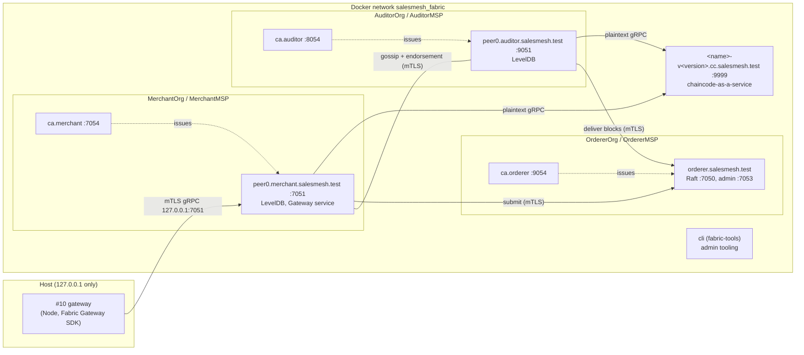

# Fabric testnet (DLT-01, #8)

A single-host, permissioned Hyperledger Fabric 2.5.16 consortium that the commission chaincode (#9) runs on and the gateway (#10) submits to. Paper §2.2.2 and §4.8.

Everything runs in Docker. No Fabric binaries are installed on the host.

The chaincode that runs on it, its function contract, roles and error codes are in [commission-chaincode.md](commission-chaincode.md).

## Topology



- Channel `commissionchannel`, created with the channel participation API (no system channel). The orderer and both peers join it.
- Capabilities: channel and orderer V2_0, application V2_5.
- State database: LevelDB. #9 needs key lookups only, so there is no CouchDB.
- Anchor peers come from `configtx/configtx.yaml`. Every peer sets a gossip external endpoint, so the Gateway on the merchant peer can discover the auditor endorser.

## Identities and policy

Every identity is issued by its own org's Fabric CA 1.5.22 (no cryptogen). Each one gets an enrollment cert (`msp/`) and a TLS pair (`tls/`) from the CA's `tls` profile. MSPs use NodeOUs (`client`, `peer`, `admin`, `orderer`).

| Identity | MSP | Type | Attributes | Used by |
|---|---|---|---|---|
| `orderer.salesmesh.test` | OrdererMSP | orderer | | orderer node |
| `Admin@salesmesh.test` | OrdererMSP | admin | | `osnadmin` |
| `peer0.merchant.salesmesh.test` | MerchantMSP | peer | | merchant peer |
| `Admin@merchant.salesmesh.test` | MerchantMSP | admin | | lifecycle, channel join |
| `gateway@merchant.salesmesh.test` | MerchantMSP | client | `role=gateway` (in ecert) | #10 gateway |
| `peer0.auditor.salesmesh.test` | AuditorMSP | peer | | auditor peer |
| `Admin@auditor.salesmesh.test` | AuditorMSP | admin | | lifecycle, channel join |
| `auditor1@auditor.salesmesh.test` | AuditorMSP | client | `role=auditor` (in ecert) | auditor queries |

#9 can read `role` with `ctx.GetClientIdentity().GetAttributeValue("role")`.

**Endorsement:** the channel default for both `Endorsement` and `LifecycleEndorsement` is `MAJORITY Endorsement`. With two orgs, that means **both** the merchant and the auditor peer must endorse.

> **Consequence:** every #10 submit fails while the auditor peer or the chaincode container is down. The smoke test proves this: an invoke endorsed by the merchant alone is rejected with `ENDORSEMENT_POLICY_FAILURE`.

## Ports

| Port | Service | Published? |
|---|---|---|
| 7051 | peer0.merchant | **yes, `127.0.0.1:7051` only** (for #10) |
| 9051 | peer0.auditor | no |
| 7050 / 7053 | orderer / orderer admin (osnadmin) | no |
| 7054 / 8054 / 9054 | CA merchant / auditor / orderer | no |
| 9999 | chaincode containers | no |

There are no operations or metrics ports.

## Operating it

```bash
make fabric-up        # or: bash blockchain/network/scripts/network_up.sh
make fabric-smoke     # full check: up, deploy, invoke, query, down; prints SMOKE PASS
make fabric-down      # removes containers, volumes, chaincode containers, generated crypto
bash blockchain/network/scripts/deploy_chaincode.sh <name> <dir> [version=1.0] [sequence=1]
```

- **First `up`** copies `.env.example` to the gitignored `blockchain/network/.env` and replaces every `*_PW` with a random secret. Permissions are set to 0600, but that is best-effort on NTFS. `down` keeps `.env`.
- **`up` refuses** to run if the network (or leftover crypto) is already there: `existing or partial network found; run network_down.sh first`. If `up` fails partway it leaves the containers for `docker logs` and prints `up failed; run network_down.sh before retrying`.
- **Readiness** is polled, never slept: each CA's `/cainfo`, `osnadmin channel list`, `peer channel list` and `getinfo`. The limit is `READY_TIMEOUT` seconds (default 60). On timeout the script names the service and gives a `docker logs` hint.
- **Deploying chaincode (#9)**: the directory needs a `Dockerfile` whose image starts a shim `ChaincodeServer` reading `CHAINCODE_ID` and `CHAINCODE_SERVER_ADDRESS`. See `blockchain/network/smoke-chaincode/` for an example. The script builds the image, installs one CCaaS package on both peers (so both get the same package ID), starts one container `<name>-v<version>.cc.salesmesh.test` (for example `smoke-v1-0`), approves for both orgs and commits. Running it again unchanged reuses the installed package, because the tarballs are reproducible. To upgrade, run it with a new version and the next sequence. The new container starts next to the old one, and the old container is removed only after the new definition is committed, so a failed upgrade keeps the old version serving.
- **Restarts:** the CAs, orderer, peers and chaincode containers use `restart: unless-stopped`, so they come back after a Docker or host restart. `cli` is restarted by the next script run.
- **Memory:** about 0.3 GB in use and 1.9 GB in limits. On a low-RAM machine, stop other containers first (for example `docker stop sm-pg sm-redis`). The scripts never stop them for you.

## Connecting #10 (gateway)

Paths are relative to `blockchain/network/organizations/peerOrganizations/merchant.salesmesh.test/` and exist once the network is up.

| What | Path |
|---|---|
| Endpoint | `127.0.0.1:7051` (cert SANs include `localhost`, `127.0.0.1`, `peer0.merchant.salesmesh.test`) |
| MSP ID | `MerchantMSP` |
| Client cert (identity) | `users/gateway@merchant.salesmesh.test/msp/signcerts/cert.pem` |
| Client private key | `users/gateway@merchant.salesmesh.test/msp/keystore/key.pem` |
| TLS client cert (mTLS) | `users/gateway@merchant.salesmesh.test/tls/client.crt` |
| TLS client key (mTLS) | `users/gateway@merchant.salesmesh.test/tls/client.key` |
| Peer TLS root CA | `peers/peer0.merchant.salesmesh.test/tls/ca.crt` |
| Channel | `commissionchannel` |

The Gateway service on peer0.merchant collects the auditor endorsement for you through discovery, so #10 connects to this one peer only. The crypto is regenerated on every `up`, so #10 must load it from these paths and must not copy it.

## Security notes

- mTLS is on for every gRPC listener: peers (`CORE_PEER_TLS_CLIENTAUTHREQUIRED`), orderer (`ORDERER_GENERAL_TLS_CLIENTAUTHREQUIRED`) and orderer admin (`ORDERER_ADMIN_TLS_CLIENTAUTHREQUIRED`, which trusts the orderer org's TLS CA only).
- **Known limit:** one CA root per org signs both the enrollment certs and the TLS certs (the CA's `tls` profile). Production would use a separate TLS CA per org.
- **Known limit:** the peer→chaincode (CCaaS) link is plaintext (`tls_required: false`). It never leaves the Docker network, and port 9999 is not published.
- No container mounts `docker.sock`. Peers run with `CORE_VM_ENDPOINT` empty and use the built-in `ccaas_builder`.
- Peers and the orderer mount only their own node directory plus the orgs' public MSPs, read-only.
- Secrets live only in the gitignored `.env`. They reach the throwaway enroller container as environment variables, so they never appear on the host command line. `fabric-ca-client` has no other input, so inside that container they are passed as arguments, and each CA's bootstrap admin password is part of its start command (visible to `docker inspect`). That is acceptable for a local dev testnet. Production would use a CA config file or HSM-backed registrar. Generated crypto, channel blocks and packages are gitignored, and the smoke test checks that `git status` shows none of them.
- Each CA's registrar key sits in `organizations/<org type>/<org>/ca-registrar/`, and the CA keys in `organizations/fabric-ca/`. This is a dev testnet, not a production key-management setup.

## Troubleshooting

| Symptom | Fix |
|---|---|
| `Docker daemon not reachable` | Start Docker Desktop or the daemon. |
| `existing or partial network found; run network_down.sh first` or `up failed; run network_down.sh before retrying` | Run `make fabric-down`, then `up` again. |
| `<service> not ready after 60s` | Run `docker logs <service>`. On a slow machine, set `READY_TIMEOUT=120`. |
| Containers OOM-killed / exit 137 | Free RAM (stop `sm-pg`/`sm-redis`) or raise `mem_limit` in the compose file. |
| `approveformyorg failed ... sequence already used` | Redeploy with a higher version and the next sequence. |
| Submit fails with `ENDORSEMENT_POLICY_FAILURE` / no endorsers | The auditor peer or the chaincode container is down: `docker ps`, then `docker logs <name>-v<version>.cc.salesmesh.test`. |
| `$'\r': command not found` | A script was checked out with CRLF. `.gitattributes` forces LF; re-checkout with `git checkout -- blockchain/network`. |
| Windows path errors | Run from Git Bash. The scripts set `MSYS_NO_PATHCONV=1` and use relative bind paths. |
